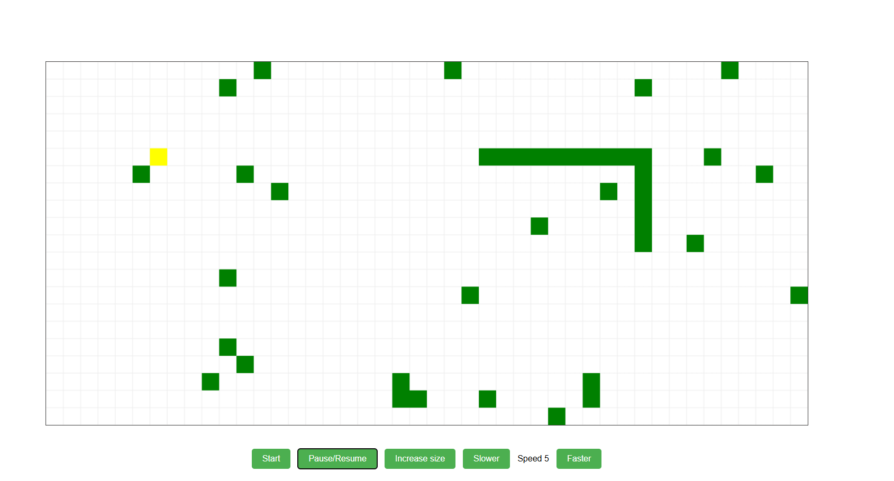

# 🐍 snakes-ai

A classic Snake game built with plain JavaScript and the HTML5 Canvas API. The long-term goal is to add an AI mode that lets the snake play itself; for now, the project contains the core game.

No frameworks, no build step, no dependencies: open `index.html` in a browser and play.

<!-- TODO: add a screenshot or GIF of the game running, e.g.  -->



## Features

- **Classic Snake gameplay** rendered on an HTML5 `<canvas>`
- **Food**: a blinking food tile appears at a random free cell (never on the snake or a hurdle); eating it makes the snake grow
- **Hurdles**: random wall tiles (about 3% of the board) are placed at the start of each game, with the top-left start area kept clear
- **Wrap-around edges**: leaving one side of the board brings the snake back on the opposite side
- **Collisions**: the game ends when the snake hits a hurdle or its own body
- **Game over screen**: a dark overlay shows why the snake died; click or press Space/Enter to play again
- **Speed control**: make the snake faster or slower while playing
- **Grid overlay** drawn on a separate canvas layer, so the board grid is rendered once and the game canvas only redraws what moves
- **Zero dependencies**: vanilla JavaScript, HTML and CSS

## Getting started

### Run locally

```bash
git clone https://github.com/picasso1807/snakes-ai.git
cd snakes-ai
```

Then open `index.html` in any modern browser.

If you prefer serving it over HTTP (recommended to avoid browser file-access quirks), any static server works:

```bash
# Node.js
npx serve .

# or Python
python -m http.server 8000
```

and visit `http://localhost:8000` (or the port shown).

## How to play

1. Click **Start** to begin a game.
2. Use the **arrow keys** to change the snake's direction.
3. Eat the blinking food to grow, and avoid the hurdles and your own body.
4. Click **Pause/Resume** to pause or continue.
5. Click **Slower** or **Faster** to change the speed, or **Increase size** to grow the snake by one tile.
6. When the game is over, click the board or press **Space**/**Enter** to start again.

## AI mode (planned)

The AI is not implemented yet. The plan is to add a self-running mode where the snake chooses its own moves, finding the food while avoiding walls and its own body. The game logic is kept in separate modules so an AI controller can be plugged in alongside manual input.

## Project structure

```
snakes-ai/
├── index.html            # Entry point: canvases, buttons, script includes
├── scripts/
│   ├── constants.js      # Game configuration (grid size, speed, colours, etc.)
│   ├── grid.js           # Board helpers: random hurdles, food placement, coordinate keys
│   ├── canvas-helper.js  # Canvas drawing: grid, snake, hurdles, blinking food, game over screen
│   ├── snake.js          # Snake state, movement, growth, collisions and move/error events
│   └── handlers.js       # Game setup, food logic, and UI/keyboard event handlers
├── styles/
│   └── styles.css        # Layout and styling for the game container and buttons
├── LICENSE
└── README.md
```

Scripts are loaded in order from `index.html` (`constants.js`, `grid.js`, `canvas-helper.js`, `snake.js`, `handlers.js`), so each file can use the ones loaded before it.

The snake doesn't know how it is drawn: it raises events (`RegisterOnMove`, `RegisterOnError`) and `handlers.js` connects them to rendering, food and the game over screen. This keeps the game logic separate, so an AI controller can be plugged in later.

## Tech stack

- JavaScript (ES6+)
- HTML5 Canvas
- CSS3

## Roadmap

- [x] Core Snake game on HTML5 Canvas
- [x] Start and Pause/Resume controls
- [x] Adjustable game speed
- [x] Food and snake growth
- [x] Random hurdles and collision detection
- [x] Game over screen with restart
- [ ] AI self-running mode
- [ ] Toggle between manual and AI play from the UI
- [ ] Live demo via GitHub Pages

## Contributing

Issues and pull requests are welcome. For larger changes, please open an issue first to discuss what you'd like to change.

## License

Released under the [MIT License](LICENSE).